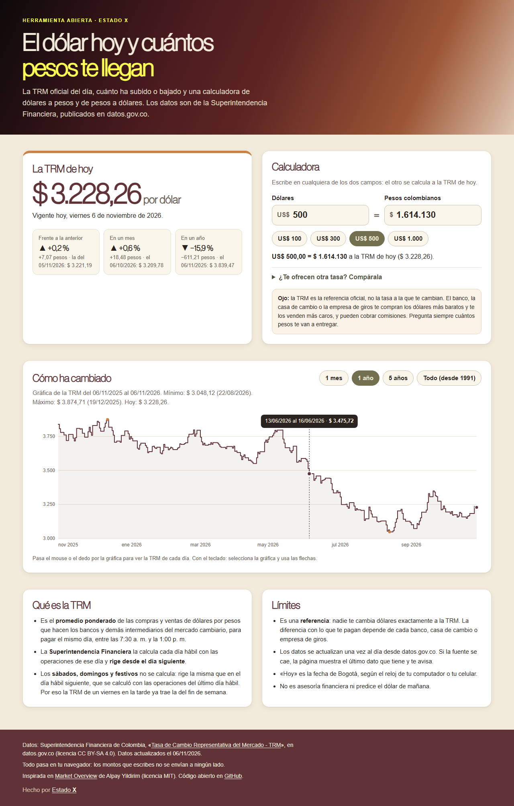

# El dólar hoy y cuántos pesos te llegan

**[Español](#español) · [English](#english)**

## Español

Herramienta abierta para ver **la TRM del día** (el dólar oficial en Colombia), cuánto ha cambiado y **cuántos pesos son tus dólares, o cuántos dólares son tus pesos**, con los datos abiertos de la Superintendencia Financiera.

**Ábrela aquí:** https://estado-x.github.io/trm-colombia/

### Qué hace

- **La TRM de hoy**, con su fecha de vigencia. Si hoy es sábado, domingo o festivo, te dice desde y hasta cuándo rige la que se fijó el último día hábil. Si ya se publicó la del día siguiente, también la muestra.
- **Cuánto cambió** frente a la TRM anterior, hace un mes y hace un año, en pesos y en porcentaje.
- **Calculadora en los dos sentidos:** dólares → pesos y pesos → dólares, a la TRM de hoy, con montos rápidos (US$ 100, 300, 500 y 1.000) y un campo para comparar con la tasa que te ofrecen el banco, la casa de cambio o la empresa de giros.
- **Gráfica** del último mes, el último año, los últimos 5 años o toda la serie (desde el 2 de diciembre de 1991), con el mínimo y el máximo del periodo. Se recorre con el mouse, el dedo o las flechas del teclado.

### Cómo funciona

- Es una página estática (HTML, CSS y JavaScript) publicada con GitHub Pages, sin servidor, sin claves y sin librerías externas. La gráfica se dibuja en SVG con código propio. Los montos que escribes **no salen de tu navegador**.
- `scripts/actualizar_datos.py` (Python 3.9+, sin dependencias) baja el histórico de la TRM de datos.gov.co y escribe `data/trm.json` y `data/corrida.json`. Revisa los datos antes de guardarlos: descarta valores imposibles y fechas repetidas, rechaza respuestas cortadas o saltos de más del 15 % entre un día y otro y, si la fuente falla, **deja los datos anteriores**.
- El flujo `.github/workflows/actualizar-datos.yml` corre ese script. Se puede correr a mano desde la pestaña Actions; la corrida diaria (10:00 p. m. de Bogotá) viene apagada y se prende quitando el `#` de las dos líneas de `schedule`.
- `assets/trm.js` tiene la lógica (TRM vigente, cambios, conversión, formato y escalas de la gráfica); `assets/app.js`, la interfaz. Las pruebas están en `pruebas/`.

### Úsala o adáptala

1. Haz un fork de este repositorio.
2. Activa GitHub Pages (Settings → Pages → rama `main`, carpeta raíz).
3. Si quieres datos diarios, prende el `schedule` del flujo (ver arriba) y dale permiso de escritura a Actions.
4. Para probarla en tu computador: `python scripts/actualizar_datos.py`, luego `python -m http.server` y abre `http://localhost:8000`. Para correr las pruebas: `node --test pruebas/` (Node 18 o superior, sin instalar nada).

### Límites

- La TRM es una **referencia oficial**, no la tasa a la que te cambian. El banco, la casa de cambio o la empresa de giros te compran los dólares más baratos y te los venden más caros, y pueden cobrar comisiones.
- Los datos se actualizan una vez al día. Si la fuente no se ha actualizado, la página muestra el último dato y te avisa.
- «Hoy» es la fecha de Bogotá según el reloj de tu dispositivo.
- No es asesoría financiera ni predice el dólar.

### Crédito y fuentes

- Inspirada en [Market Overview](https://github.com/IDouble/Market-Overview-Indexes-Forex-Metals-Crypto) de Alpay Yildirim (licencia MIT), un tablero de mercados con widgets de TradingView. No reutiliza su código.
- Datos: Superintendencia Financiera de Colombia, [«Tasa de Cambio Representativa del Mercado - TRM»](https://www.datos.gov.co/d/32sa-8pi3), en datos.gov.co, con licencia [CC BY-SA 4.0](https://creativecommons.org/licenses/by-sa/4.0/). El archivo `data/trm.json` es una copia compacta de esos datos y conserva esa licencia.
- Metodología de la TRM: Banco de la República, Circular Reglamentaria Externa DOAM-146, «Metodología de cálculo de la Tasa de Cambio Representativa del Mercado».

### Hecho por Estado X

[Estado X](https://estadox.com) · Código con licencia MIT (los datos, CC BY-SA 4.0).

---

## English

An open tool that shows **Colombia's official exchange rate (TRM) for today**, how much it has changed, and **how many pesos your dollars are worth, or how many dollars your pesos buy**, using open data from the Financial Superintendence of Colombia.

**Open it here:** https://estado-x.github.io/trm-colombia/

### What it does

Today's TRM with its validity dates (weekend and holiday rates are set on the last business day), the change versus the previous rate, a month ago and a year ago, a two-way USD ↔ COP calculator with a field to compare the rate your bank or money-transfer service offers, and a hand-drawn SVG chart (1 month, 1 year, 5 years or the full series since December 1991).

### How it works

A static page on GitHub Pages: no server, no keys, no external libraries, and **the amounts you type never leave your browser**. A standard-library Python script downloads the series from datos.gov.co, checks it (impossible values, duplicate dates, truncated responses) and keeps the previous data if the source fails. The daily GitHub Actions schedule ships disabled. Tests: `node --test pruebas/`.

### Limits

The TRM is an official reference, not the rate you will get when exchanging money. Not financial advice.

### Credits

Inspired by [Market Overview](https://github.com/IDouble/Market-Overview-Indexes-Forex-Metals-Crypto) by Alpay Yildirim (MIT); no code reused. Data: Superintendencia Financiera de Colombia on datos.gov.co (CC BY-SA 4.0).

### Made by Estado X

[Estado X](https://estadox.com) · Code under the MIT License (data under CC BY-SA 4.0).
